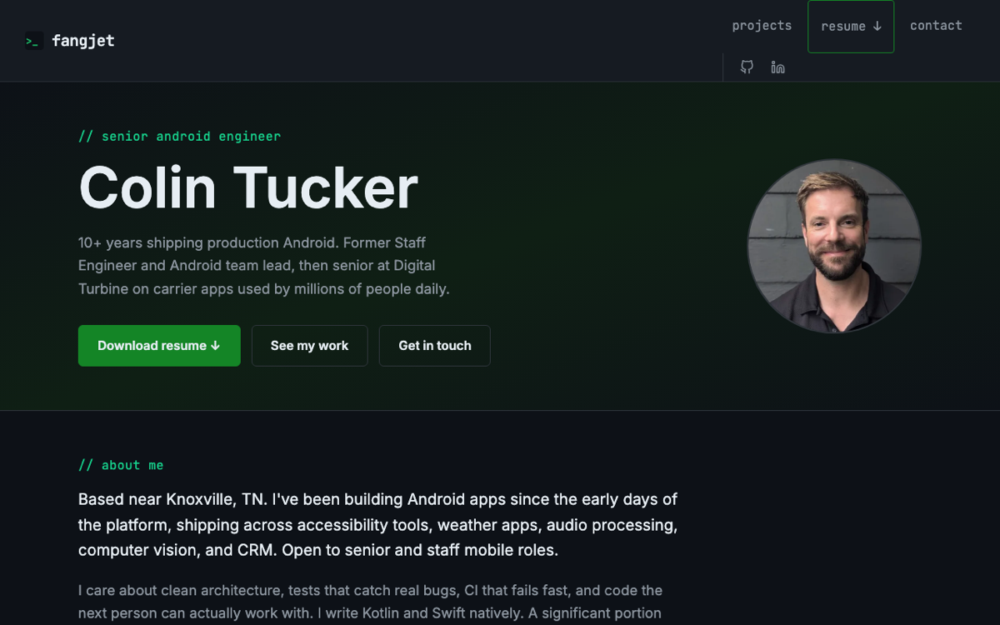

# fangjet.com

**The portfolio of Colin Tucker, senior Android engineer.** Hand-built with React, prerendered to static HTML, and served from Firebase Hosting.

[](https://fangjet.com)
[](LICENSE)


<p align="center">
  <a href="https://fangjet.com">
    
  </a>
</p>

I'm an Android engineer, and I built this site in React to understand what the framework does before
adding another one on top. The goal was a site I'd be happy to inherit: fast, searchable, secured, and
small enough to read in an afternoon.

**Looking for a senior or staff mobile engineer?** See the [projects](https://fangjet.com/projects),
grab the [resume](https://fangjet.com/colin-tucker-resume.pdf), or [get in touch](https://fangjet.com/contact).

## What's inside

- **Prerendered, then hydrated.** The build renders every route to plain HTML (`scripts/prerender.mjs`), so
  pages load fast and crawlers and link previews see real content. React takes over in the browser.
- **Per-page SEO.** Titles, descriptions, canonical URLs and social previews rendered with React 19's native head tags
  (`src/components/SEO.jsx`, no head library), schema.org JSON-LD for the person and the projects, a sitemap, and a real
  `noindex` 404 page. The build fails if any page is missing or duplicating a tag.
- **Security headers and caching.** A strict Content-Security-Policy, HSTS, `X-Frame-Options` and friends,
  immutable caching for hashed assets, and `no-cache` for the HTML shells. All of it lives in
  [`firebase.json`](firebase.json).
- **Design tokens in Tailwind v4.** The palette, fonts and breakpoints are defined once in a `@theme` block
  in [`src/styles/global.css`](src/styles/global.css), so components never hard-code a colour.
- **No cookies and no cross-site tracking.** Visits are counted with Cloudflare Web Analytics, which is
  cookieless, and the only personal data the site handles is a contact form message, delivered by Formspree.

## Lighthouse

Measured against the live site in October 2026, on the home, projects and contact pages:

| | Performance | Accessibility | Best Practices | SEO |
|---|---|---|---|---|
| Mobile | 98 to 100 | 92 to 95 | 100 | 100 |
| Desktop | 100 | 92 to 95 | 100 | 100 |

Fonts are self-hosted and preloaded, every route is prerendered, and the whole JavaScript bundle is about 100 KB gzipped.

## Stack

| | |
|---|---|
| UI | React 19, React Router |
| Build | Vite, a custom SSR prerender step |
| Styling | Tailwind CSS v4 (`@tailwindcss/vite`), a handful of custom classes |
| SEO | React 19 native metadata, JSON-LD, sitemap, robots.txt |
| Forms | Formspree |
| Hosting | Firebase Hosting, with Cloudflare for DNS |
| Lint | oxlint |

## Running it

```bash
npm install
npm run dev       # local dev server
npm run lint      # oxlint
npm run build     # client build, SSR build, then prerender every route into dist/
npm run preview   # serve dist/ locally
```

## Deploying

```bash
npm run build
firebase deploy --only hosting
```

`firebase.json` serves `dist/`, sets the security and caching headers, answers unknown paths with the
prerendered 404 page, and 301-redirects the old WordPress URLs (`/about`, `/services`) to the home page.

## Layout

```
src/
  pages/             one component per route (Home, Projects, AI, Contact, the privacy policies)
  components/        Nav, Footer, ProjectCard, SEO and friends
  styles/            global.css: Tailwind, design tokens and the remaining custom CSS
  entry-server.jsx   SSR entry used by the prerender step
public/              copied as-is: sitemap, robots.txt, résumé, images
scripts/             prerender.mjs
docs/                the screenshot above
```

## License

Released under the [MIT License](LICENSE). © FangJet LLC.
